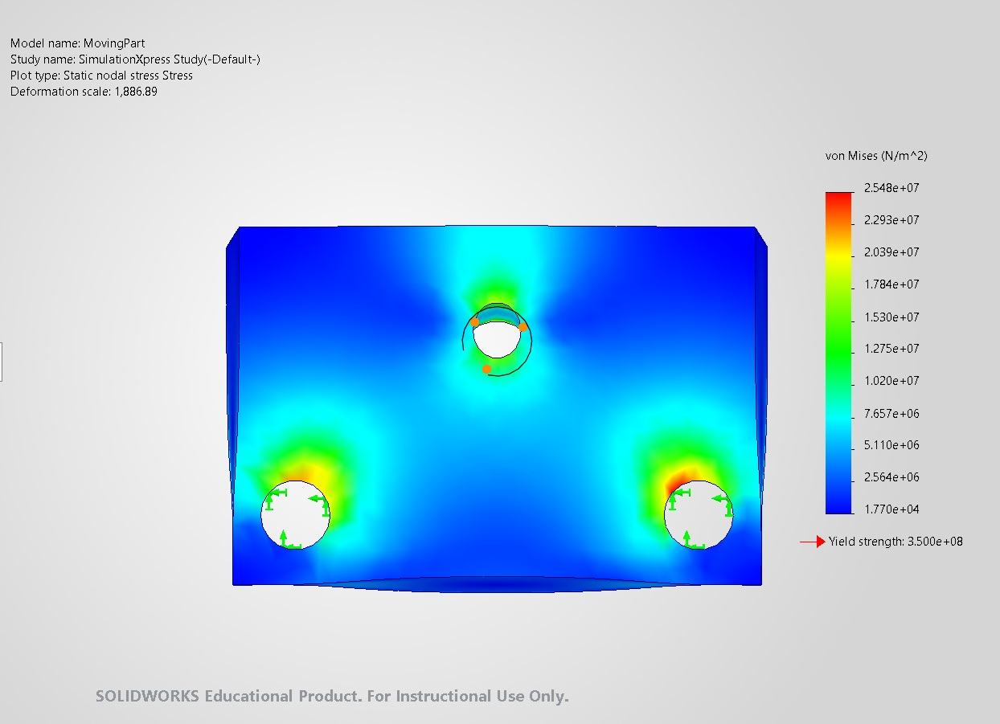
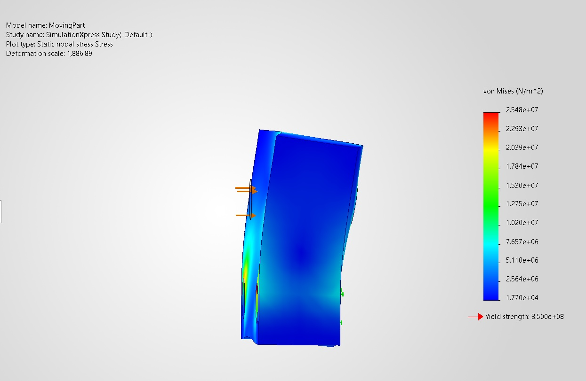
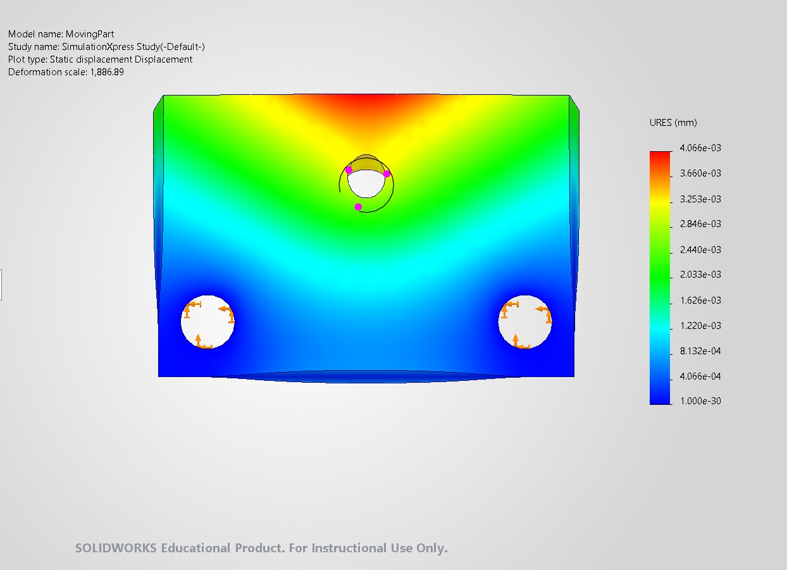
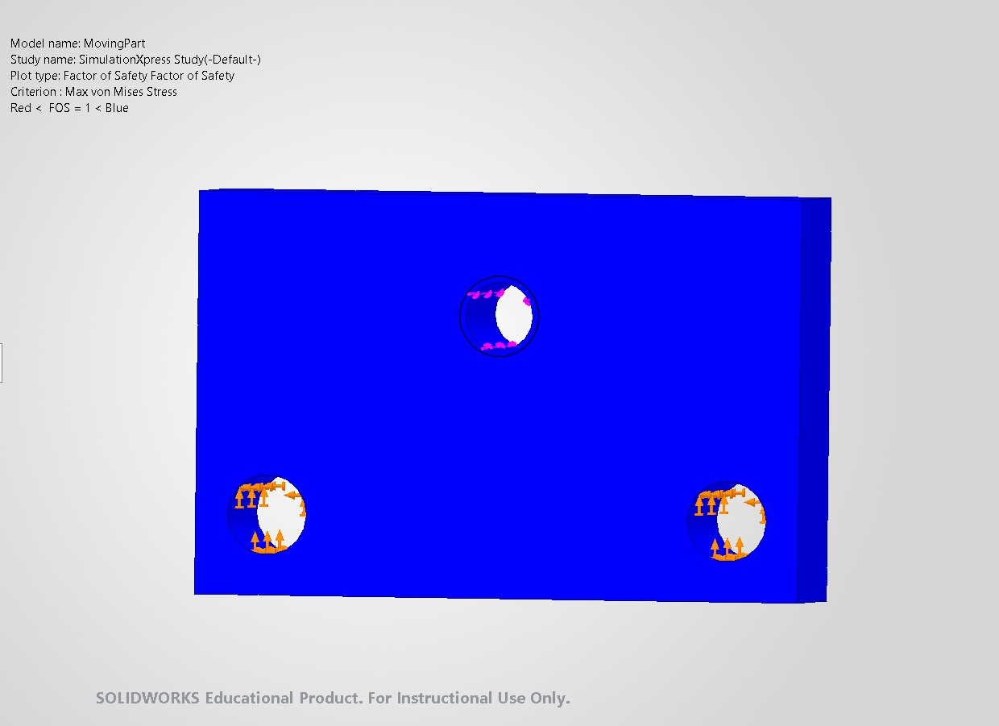

# MovingPart SimulationXpress Analysis

## Analysis Objective

Evaluate the preliminary static response of `MovingPart` under the estimated lead-screw clamping load. The study checks von Mises stress, displacement, and factor of safety using a simplified single-part model in `SOLIDWORKS SimulationXpress`.

## Study Definition

| Parameter | Study input |
|---|---|
| Component | `MovingPart` |
| Simulation tool | `SOLIDWORKS SimulationXpress` |
| Analysis type | Linear static, single component |
| Material | `AISI 1020 Steel, Cold Rolled` |
| Yield strength | 350 MPa from the SOLIDWORKS material library |
| Applied force | 1885 N |
| Load location | M10 lead-screw interface |
| Load direction | Along the `Lead Screw` axis |
| Fixtures | Cylindrical faces of the two `Guide_Rod` holes |

The 1885 N load is the preliminary clamping force estimated from the project handwheel and lead-screw calculations. Applying it at the M10 interface represents axial load transfer from `Lead Screw` into `MovingPart`. The two guide-rod holes were selected as fixtures to represent support from the `Guide_Rod` components.

## Simplified Boundary Condition

> **This is a preliminary simplified analysis.** SimulationXpress treats the selected fixture faces as fully fixed. In the real assembly, `MovingPart` slides along the `Guide_Rod` components and is not fully fixed at those interfaces. The fixture therefore provides a useful first estimate but makes the local constraint stiffer than the real mechanism.

## Analysis Procedure

1. Opened the `MovingPart` part file.
2. Started `SOLIDWORKS SimulationXpress` and created a static study.
3. Fixed the cylindrical faces of the two guide-rod holes.
4. Applied a 1885 N force at the M10 lead-screw interface, directed along the `Lead Screw` axis.
5. Assigned `AISI 1020 Steel, Cold Rolled` from the SOLIDWORKS material library.
6. Ran the study and reviewed stress, displacement, and factor-of-safety plots.

## Results Summary

| Result | Maximum / minimum value | Preliminary interpretation |
|---|---:|---|
| Maximum von Mises stress | Approximately 25.5 MPa | Below the 350 MPa library yield strength for the simplified study. |
| Maximum displacement | Approximately 0.0041 mm | Small predicted elastic movement under the simplified constraints. |
| Minimum factor of safety | Approximately 13.74 | High preliminary static margin relative to library yield strength. |

The factor-of-safety value is consistent with `350 MPa / 25.5 MPa ≈ 13.7`, subject to plot rounding.

## Stress Results

The von Mises plot combines the multiaxial stress state into one equivalent stress that can be compared with the yield strength of a ductile material. Blue areas carry lower equivalent stress; green, yellow, and red areas carry progressively higher stress according to the displayed legend.

The maximum reported value is approximately 25.5 MPa. Elevated local stresses appear near the fixed guide-rod holes and around the loaded M10 interface. Peaks adjacent to fully fixed faces can be influenced by the idealized boundary condition and may not represent the real sliding contact.

**Figure 1.** Front view of the von Mises stress result. The legend maximum is approximately `2.548 × 10^7 N/m² = 25.48 MPa`.

**Figure 2.** Side view showing the applied axial force direction and the displayed deformed shape. The reported deformation scale is approximately `1886.89`, so the visible bending is strongly exaggerated for interpretation.

## Displacement Results

Displacement represents the calculated movement of each point from its original position. The plot displays resultant displacement magnitude (`URES`). The maximum reported displacement is approximately 0.0041 mm.

The colour map shows relative displacement across the part, from low values in blue to high values in red. The displayed deformed shape is magnified automatically because the true displacement is too small to see at normal model scale.

**Figure 3.** Resultant displacement plot. The legend maximum is approximately `4.066 × 10^-3 mm = 0.0041 mm`.

## Factor-of-Safety Results

Factor of safety compares material yield strength with calculated equivalent stress. A value greater than 1 indicates that the calculated stress is below the specified yield strength for the analysed load case. The reported minimum is approximately 13.74.

**Figure 4.** Factor-of-safety plot based on maximum von Mises stress and the 350 MPa yield strength stored in the selected material definition.

## Interpretation

- The simplified study predicts stress well below the selected material-library yield strength.
- The predicted displacement is small for this idealized support condition.
- The minimum factor of safety indicates a high preliminary static margin for the analysed part and load case.
- These results apply only to the current single-part model, material assignment, mesh, load, and fixture definition.
- Stress peaks near the fixed holes require caution because fully fixed geometry can create artificial local stress concentrations.

## Limitations

- SimulationXpress analyses a simplified single component rather than the complete `AssemReady` assembly.
- The guide-rod holes are fully fixed, while the real `MovingPart` slides along two `Guide_Rod` components.
- The M10 threaded load transfer is represented as a simplified applied force rather than detailed thread contact.
- Contact, clearance, friction, guide-rod flexibility, jaw contact, lead-screw support, preload, and assembly misalignment are not represented.
- The analysis assumes linear elastic material behaviour and a static load case.
- Local results depend on mesh density and boundary-condition idealization; a dedicated convergence study has not been documented.
- Material-library properties must be confirmed against the material actually purchased and manufactured.
- The results support the current `MovingPart` geometry as a preliminary concept under the 1885 N estimated axial load, but they do not validate the complete fixture.
- The next stage should use full SOLIDWORKS Simulation with assembly contacts, realistic guide-rod constraints, load-path verification, mesh refinement, and comparison with analytical calculations and physical testing.
