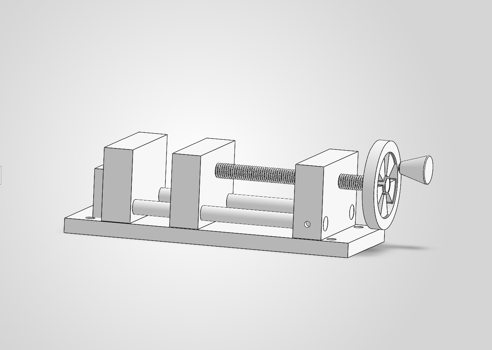
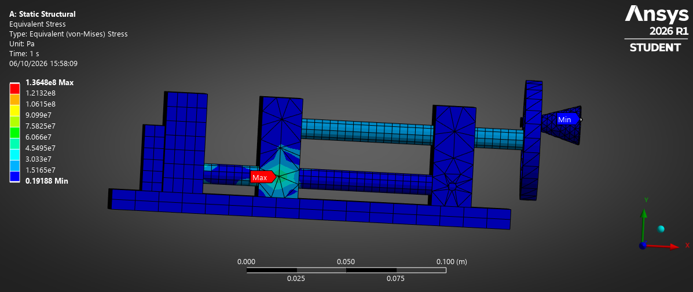
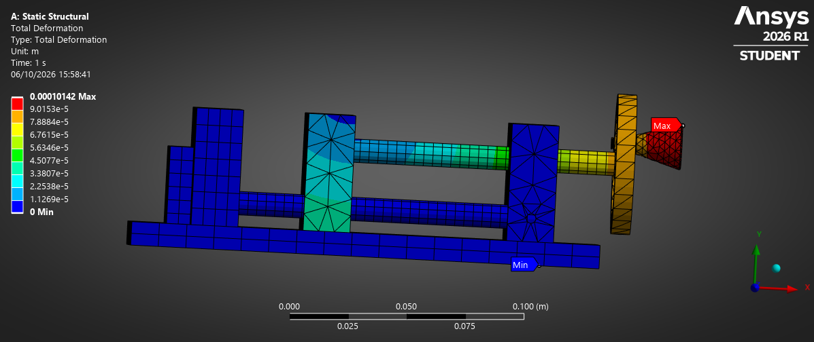
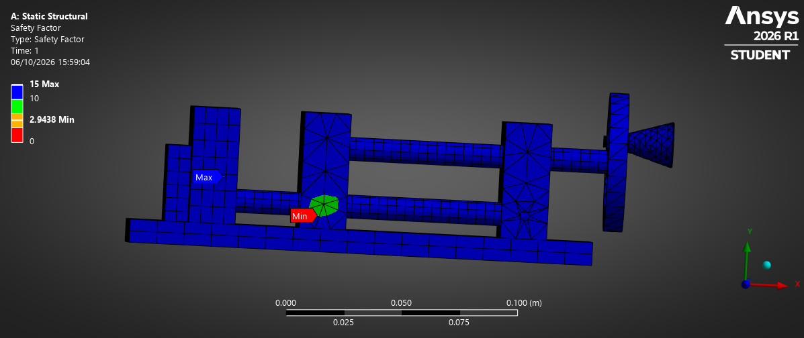
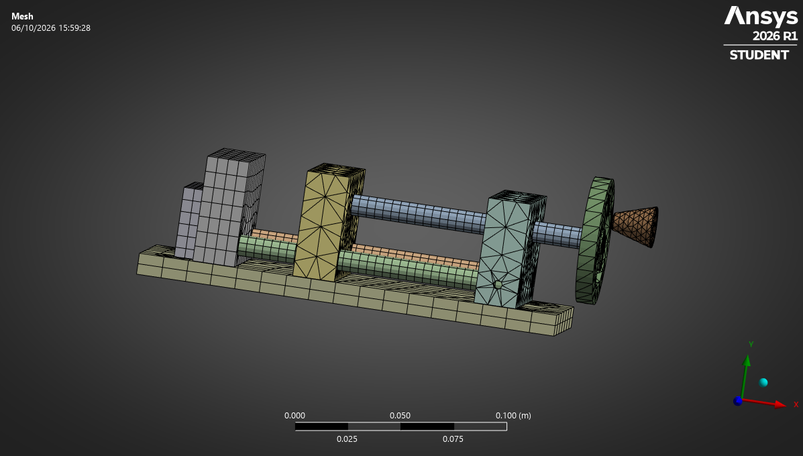
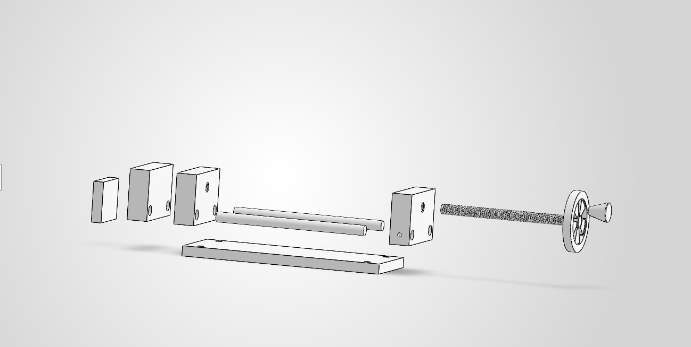

# Project 2 – Manual Adjustable Workpiece Fixture

## Overview

A manually adjustable workpiece fixture / mini vise designed in SOLIDWORKS. The mechanism combines a lead screw, a moving jaw, fixed jaw components, two guide rods, a support block, a handwheel and handle, and a base plate. Rotating the handwheel drives `Lead Screw`, creating linear motion of `MovingPart` to clamp a workpiece.

The project includes mechanical design, DFM/DFA considerations, engineering calculations, drawings and BOM, part-level SimulationXpress studies, and full-assembly ANSYS analysis.



## Main Components

- `Base_Plate`
- `Guide_Rod` ×2
- `Fixed_Jaw_New`
- `Fixed Jaw`
- `MovingPart`
- `NonMovingPart`
- `Lead Screw`
- `Wheel`
- `Handle`

## Key Design Data

| Parameter | Value |
|---|---|
| Base plate | 200 × 80 × 10 mm |
| Guide rods | Ø10 × 150 mm |
| Lead screw | M10×1.5 |
| Lead screw nominal length | 140 mm |
| Lead / travel per revolution | 1.5 mm/rev |
| Handwheel diameter | ≈60 mm |
| Handwheel radius used in calculations | 30 mm |
| Assumed hand force | 50 N |
| Estimated input torque | 1.5 N·m |
| Estimated clamping force | ≈1885 N |

## Engineering Calculations

The preliminary calculations cover:

- Lead screw travel
- Number of revolutions
- Input torque from the handwheel
- Estimated clamping force
- Lead screw stress
- Guide rod bending and deflection
- Factor of safety

See the [calculations](Calculations/Project_2_Calculations_EN.md) or [PDF](Calculations/Project_2_Calculations_EN.pdf). The clamping force is an estimate based on an assumed 50 N hand force and 30% thread efficiency, rather than a measured load.

## SolidWorks SimulationXpress

Simplified part-level static studies of `MovingPart`, `Lead Screw`, and `Guide_Rod` were performed before the full-assembly ANSYS study. These studies provided preliminary stress, displacement, and safety-factor estimates under idealized constraints.

The [MovingPart study](Documentation/MovingPart_Simulation_EN.md) ([PDF](Documentation/MovingPart_Simulation_EN.pdf)) documents the fully fixed guide-rod-hole simplification. Selected result plots for [Lead Screw](Images/Analysis/LeadScrew_VonMises_Stress.jpg) and [Guide_Rod](Images/Analysis/GuideRod_VonMises_Stress.jpg) are also available.

## ANSYS Mechanical – Full Assembly Analysis

A Static Structural study in ANSYS Mechanical 2026 R1 Student evaluated a simplified model of `AssemReady` under the estimated 1885 N clamping force.

- The modeled `Lead Screw` thread was suppressed for mesh stability.
- `Guide_Rod` ↔ `MovingPart` contacts were modeled as Frictionless.
- `MovingPart` ↔ Base was modeled as Frictionless.
- `Lead Screw` ↔ `MovingPart` was modeled as Bonded to simplify the threaded connection.
- The final `Lead Screw` axial support used Remote Displacement.
- The final mesh contained 65,406 nodes and 33,417 elements.

An initial non-physical solution was rejected after reviewing the boundary conditions. The support model was refined before accepting the current results, demonstrating the need to assess physical behavior alongside solver output.

See the [ANSYS assembly analysis](Documentation/Project_2_ANSYS_Assembly_Analysis_EN.md) or [PDF](Documentation/Project_2_ANSYS_Assembly_Analysis_EN.pdf).

### Final ANSYS Results

| Result | Final Value | Location |
|---|---:|---|
| Maximum Equivalent Stress | 136.48 MPa | Guide_Rod |
| Maximum Total Deformation | 0.10142 mm | Handle |
| Minimum Safety Factor | 2.9438 | MovingPart |

The deformation result image is displayed at **1.0 True Scale**.

These are preliminary engineering results for the current modeling assumptions and are not final physical-product certification.

### Equivalent Stress



Maximum equivalent stress: 136.48 MPa on `Guide_Rod`.

### Total Deformation – True Scale



Maximum total deformation: 0.10142 mm on `Handle`.

### Safety Factor



Minimum safety factor: 2.9438 on `MovingPart`.

### Finite Element Mesh



Final mesh: 65,406 nodes and 33,417 elements.

## Analysis Cross-Check

| Evaluation | Guide rod bending stress |
|---|---:|
| Cantilever hand calculation | ≈144 MPa |
| SOLIDWORKS SimulationXpress | ≈139 MPa |
| ANSYS full assembly | 136.48 MPa |

The similar order of magnitude provides a useful sanity check, but not exact validation because boundary conditions and modeling assumptions differ. The ≈144 MPa value uses the later cantilever approximation documented in the ANSYS report; the preliminary calculations document uses an earlier simply supported model.

## Documentation

| Category | Markdown / files | PDF |
|---|---|---|
| Requirements | [Requirements](Requirements/Project_2_Requirements_EN.md) | [PDF](Requirements/Project_2_Requirements_EN.pdf) |
| BOM | [Bill of materials](BOM/Project_2_BOM_EN.md) | [PDF](BOM/Project_2_BOM_EN.pdf) |
| Calculations | [Engineering calculations](Calculations/Project_2_Calculations_EN.md) | [PDF](Calculations/Project_2_Calculations_EN.pdf) |
| Simulation documentation | [MovingPart SimulationXpress](Documentation/MovingPart_Simulation_EN.md) | [PDF](Documentation/MovingPart_Simulation_EN.pdf) |
| ANSYS assembly analysis | [Assembly analysis](Documentation/Project_2_ANSYS_Assembly_Analysis_EN.md) | [PDF](Documentation/Project_2_ANSYS_Assembly_Analysis_EN.pdf) |
| Drawings | [SOLIDWORKS engineering drawings](Drawings/) | — |

## Exploded View and Drawings



Engineering drawings are available in the [Drawings folder](Drawings/), including the [isometric drawing](Drawings/Isometric_Drawing.SLDDRW) and [exploded-view drawing](Drawings/Explode_View_Drawing.SLDDRW). The main CAD assembly is [AssemReady](SolidWorks/AssemReady.SLDASM).

## Project Structure

```text
Project 2/
├── BOM/
├── Calculations/
├── Documentation/
├── Drawings/
├── Images/
├── Requirements/
├── SolidWorks/
└── README.md
```

## Software Used

- SOLIDWORKS Student Edition
- SOLIDWORKS SimulationXpress
- ANSYS Mechanical 2026 R1 Student

## Project Status

Mechanical design, engineering documentation, calculations, part-level preliminary simulation, and full-assembly preliminary structural analysis completed.

Future work:

- Mesh convergence study
- More detailed threaded contact modeling
- Physical prototype testing
- Comparison with experimental measurements
